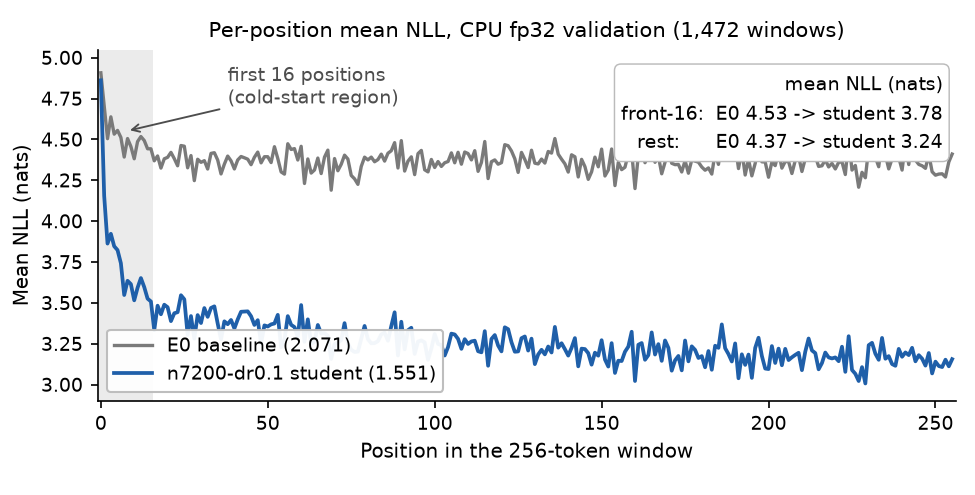
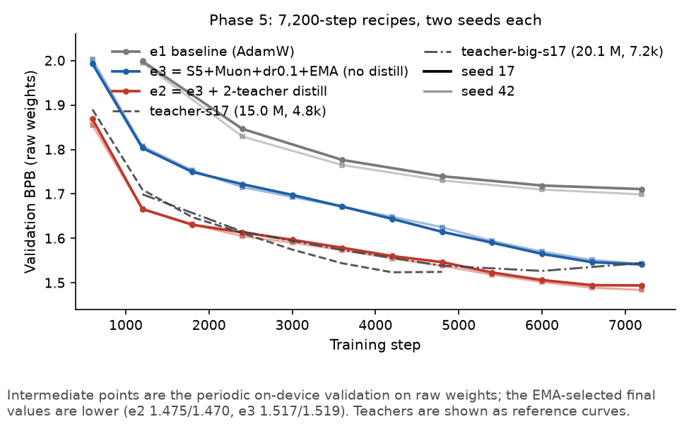
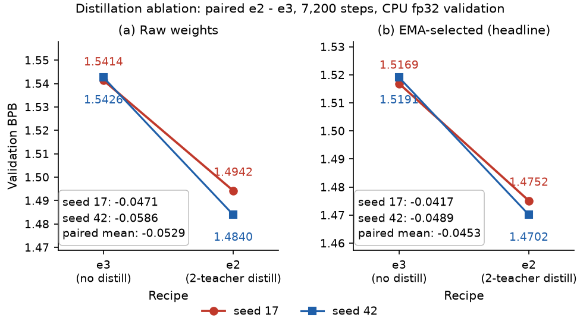
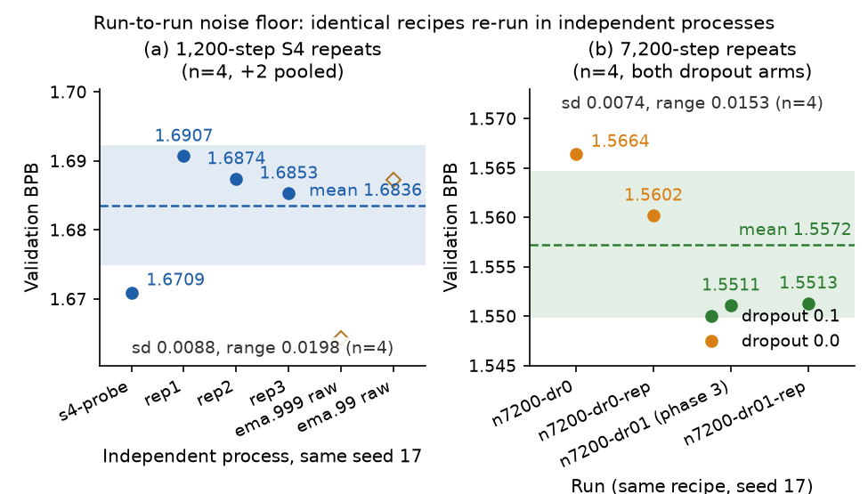

# DASE7506 MP1 — Small Language Model Challenge · Report
Student ID 3036837693 (Wang Yucheng) | 2026-09-22 | protocol `7506-mp1-wt2-v2` | code https://github.com/ethanwang2747/DASE7506hw1

A Chinese version of this report is in report.md.

Unless noted otherwise, every BPB is measured on **CPU fp32, validation split, selected weights**. Reviewable material: `checkpoint.pt`, `config.json`, `score_test.json`, `RUN_LOG.csv`, `report/evidence.csv` (one line per run, from its `metrics.json`) and `report/figs/`.

## 1. Summary and final score

The method runs on a **pre-norm architecture stack (RMSNorm / SwiGLU / QK-Norm / zero-init / tied head) + Muon + a long schedule at 8.9M capacity (28,800 steps ≈ 65 epochs) + EMA + three generations of born-again two-teacher distillation (T=4, α=0.7)**, plus a hyper-parameter descent that moves one knob at a time with paired seeds. test 2.1013 → **1.4269** (−0.674 BPB): the paired distillation ablation is worth −0.0453, the architecture stack with Muon −0.18~−0.23 as a bundle. All three resource limits pass when measured; the per-run data ships as `report/evidence.csv`.

| Item | Value | Source |
|---|---|---|
| Initial baseline E0: validation / **test** BPB | 2.0711 / **2.1013** | `report/evidence.csv` |
| Same-recipe baseline at 7,200 steps (mean over two seeds) | 1.7049 | `report/evidence.csv` |
| Final frozen validation BPB | **1.407431** | `report/evidence.csv` |
| **Final frozen test BPB** | **1.426939** | `score_test.json` |
| test time | **28.72 s** vs 6.11 s = **4.70×** (old anchor 6.55 s → 4.39×) | `RUN_LOG.csv` |
| Peak memory | **2.12 GiB** (2,220,248 kB, /usr/bin/time -v) | `RUN_LOG.csv` |
| Uncompressed asset | 35,652,341 B ≈ **34.0 MiB** (8,907,696 parameters) | `checkpoint.pt` |

val 1.4074 is the minimum over about 100 runs; its recipe family (same recipe, two seeds) averages 1.4080, and the val→test drift is +0.0195 (E0 anchor +0.0302; see §6.1, §8).

## 2. Protocol and constraints

### 2.1 Scoring convention

BPB is defined as

```
BPB = Σ_w Σ_t ( −log2 P(correct token) ) ÷ all original UTF-8 bytes of that split
```

Two points are easy to misread. (1) **The denominator is bytes, not tokens**, and the tokenizer is fixed. (2) The text is BPE-encoded and cut into **non-overlapping 256-token windows** (a short final window included); windows carry no state and share one boundary token. **Each target is scored exactly once**; the first token is not scored but its bytes count in the denominator. The evaluator also requires shape `[batch, time, 2048]`, finite entries (no `-inf` in a mask) and `|logsumexp(logp, -1)| ≤ 1e-3`.

| split | scored targets | UTF-8 bytes | tokens |
|---|---:|---:|---:|
| train | —— | 10,951,562 | 3,613,343 |
| validation | 376,599 | 1,148,007 | 376,600 |
| test | 428,405 | 1,292,013 | 428,406 |

The test/val byte ratio is 1.1254 and the target ratio 1.1376; both extrapolate validation timings to test. Development and selection use validation only: test has been run 3 times by the **baseline family** (E0 twice, one 10-step smoke run) and 0 times by **candidate student models**.

### 2.2 The three resource limits and the budget conversion

All three limits are measured on **one and the same frozen predictor**; `evaluate.py`'s `device_metrics()` returns 0 on CPU, so measure them outside.

| Limit | Budget | Measured on the frozen model |
|---|---|---|
| CPU time ≤ 5× | test 6.5496 s ⇒ **32.75 s** | **28.72 s** vs 6.11 s = **4.70×** |
| Peak memory | ≤ 4 GiB | **2.12 GiB** (2,220,248 kB, /usr/bin/time -v) |
| Uncompressed asset | ≤ 64 MiB (≤ 16,777,216) | 35,652,341 B ≈ **34.0 MiB** (8,907,696) |

The time budget anchors every size decision: the a-priori conversion "5× ≈ 4× FLOPs ≈ 4.1–4.5M parameters" is conservative — the 8.9M frozen model costs only 4.70× — and a starting point only. Read the budget off the baseline `seconds` on the actual machine (server CPUs are slower; the same model takes 29–40 s).

### 2.3 Routes excluded by the constraints

| Route | Why it is excluded |
|---|---|
| kNN-LM / retrieval augmentation | datastore ≈ 922 MB ≫ 64 MiB; CPU retrieval would blow the 5× time limit |
| dynamic evaluation / test-time training | the backward pass at evaluation time exceeds the 5× CPU time |
| int8 quantization to enlarge a single model | evaluation is fixed to CPU FP32 and de-quantised inference times out |
| direct weight averaging across seeds | the loss basins differ; in-trajectory EMA and logit ensembling remain available |
| pure Mamba / linear attention | `selective_scan` is CUDA-only and is slower on CPU at short sequence lengths |
| n-gram output-side interpolation | measured as ineffective on another machine; §3.1 gives the upper bound on its size |

### 2.4 Compliance evidence (re-checked after every experiment)

- The default path is bit-identical: the `--implementation model --steps 10` smoke test reproduces checkpoint sha256 `2ce13a32…`, validation BPB `3.579821969345922` and the step-10 loss exactly (on an idle machine; otherwise only to 6e-11 relative).
- Contract tests 5/5 OK; the protected files (`model.py` / `common.py` / `evaluate.py` / `tests/` / `configs/baseline.json` / `data/*`) agree with the distributed package member by member in sha256.

## 3. Diagnosis: where the limit is

The protocol has two hard constraints: **independent 256 windows** and **curriculum text fixed at 3.61M tokens**.

### 3.1 Per-position loss: the window cold start is real but small

Replicating the scorer's windows and averaging the NLL per position (check: Σ(per-position NLL × count) reproduces its BPB, 2.0710809705 vs 2.0710809771 for E0):

| Metric | Baseline (val 2.0711) | Trained student (val 1.5511) |
|---|---:|---:|
| mean NLL at position 0 | 4.9074 nats | 4.8614 nats |
| first 16 positions | 4.5294 | 3.7751 |
| last 16 positions | 4.3530 | 3.1508 |
| first 16 / last 16 | 1.0405 | **1.1981** |
| remaining positions of the window | 4.3659 | 3.2442 |
| share of total NLL in the first 16 (token share 6.25%) | 6.47% | 7.20% |
| **cold-start excess as a share of total NLL** | 0.25% | **1.19%** |

For the trained student the first 16 positions cost about 20% more than the tail and carry about 1.2% of its total NLL; making them as cheap as the tail is worth **≈0.018 BPB** (1.5511 → ≈1.533) — 1/3 of the "+1.31M parameters of capacity" return (0.0506), 2.7× the seed spread (0.0068), an order of magnitude short of supporting a strategy. **The stronger the model, the more the residual loss concentrates in the first few tokens** (0.25% → 1.19%). See Figure 1.

**Figure 1. Mean NLL per position in the 256-token windows (E0 vs trained student).**


### 3.2 Data vs parameters: the real limit is "data-constrained + many epochs"

The classroom training text is only **3,613,343 tokens**: 1,200 steps = 9,830,400 targets ≈ 2.7 epochs, 7,200 steps ≈ **16.3 epochs**, 14,400 ≈ **32.6 epochs**. The 1.09M-parameter baseline recipe has 3.3 tokens/parameter, the 6.64M candidate student only **0.54**. "More parameters" was ruled out at first (8.1M did not beat 6.6M in the fast screen), then overturned: capacity pays off only **with a long schedule and regularisation** — at 7,200 steps and dropout 0.1 the 8.9M model overtakes 6.6M (paired −0.009), and roughly doubles it at 14,400 steps. The main axis is **training method × capacity**. The teachers already overfit (the 15.0M / 4,800-step teacher at 1.5246 beats the 20.1M one, §6.3), the students do not (no rebound in the tail of the four 7,200-step arms; dropout 0.1 removes the dropout-0 arm's late upturn, §5.4).

## 4. Method

### 4.1 Architecture stack (`code/student.py`, a single self-contained file)

Changes relative to the classroom baseline (`model.py`: LayerNorm + 4×GELU + learned positions + tied head):

| Change | Content | Rationale |
|---|---|---|
| RMSNorm replaces LayerNorm | compute in float, then write back in the original dtype | fp16/bf16 numerical stability |
| SwiGLU replaces GELU-4× | hidden = 8/3 × width, rounded to a multiple of 8 | matches the 3·width·hidden budget |
| QK-Norm | RMSNorm over each attention head's dimension | stabilises long-schedule training |
| zero-init | `attn.proj.weight` and `mlp.down.weight` set to zero | every block starts as the identity map |
| tied head / no bias | `tie=True`, `bias=False` | same as the baseline; untying brings no gain (§5.4) |
| position encoding | keep learned absolute positions | context is fixed at 256, so RoPE buys very little |

All architecture code must live in one file (`common.make_model()` sha256s **single-file** implementations only); the checkpoint must be rebuildable from `config` alone (asserting `context == 256`, `vocab == 2048`).

| Item | Value in the frozen recipe |
|---|---|
| model | vocab 2048 / w336 / h6 / d6 / ctx 256; RMSNorm, SwiGLU, QK-Norm |
| dropout | 0.05 |
| optimizer | Muon (lr 0.03, momentum 0.95, decoupled wd 0.05) + AdamW (lr 1e-3), clip 1.0 |
| schedule | 100-step warmup + cosine decay to 10% of the peak, 28,800 steps in total; 32×256 = 8,192 per step |
| EMA / distillation / seed | 0.9995 (EMA 1.407431 / raw 1.433284); T=4.0, α=0.7; seed 42 |

### 4.2 Muon optimizer

Five-step Newton–Schulz orthogonalisation (coefficients 3.4445, −4.7750, 2.0315, in bfloat16). Only 2D `nn.Linear` matrices outside the output head go to Muon; embeddings, norm gains, biases and the head stay on AdamW. Updates are scaled by `max(1, rows/cols)**0.5`. The default path stays bit-identical (§2.4).

### 4.3 Long schedule + dropout

Each step draws 32 random start offsets, taking 257 consecutive tokens each (32×256 = 8,192 targets). The baseline recipe is AdamW lr 1e-3 / weight_decay 0.1 / clip 1.0, 100 warmup steps, cosine decay to 10% of the peak. Dropout is applied after the embedding and in each residual branch; `nn.Dropout` is the identity map in eval mode, so **scoring is unaffected**. `--steps` also sets the cosine period, so "training longer" and "changing the schedule shape" are entangled — a 4,800-step run is not a prefix of a 7,200-step run (at step 4,800 the former sits at 1.6289, the latter has converged to 1.5596).

### 4.4 EMA (exponential moving average)

The shadow weights are updated after every `optimizer.step()`: `avg = decay·avg + (1−decay)·param`; after training, raw and averaged weights are each scored once on validation in CPU fp32, the better one going into the checkpoint. **The horizon must match the schedule length**: keep `1/(1−decay)` at ≲ 15% of the step budget. 7,200 steps use 0.999 (horizon 1,000 steps = 13.9%, negligible initialisation residue); 14,400 use 0.9995; 1,200 can only use 0.99 — 0.999 over 1,200 steps leaves 30% of the random initialisation in the average and EMA is worse by 0.366 BPB.

### 4.5 Multi-teacher ensemble distillation (core mechanism)

The loss is computed per token as `α·T²·KL(log_softmax(student/T) ‖ teacher_softmax) + (1−α)·CE`. With several teachers, the log-probabilities are averaged arithmetically after each softmax and renormalised (a renormalised **geometric mean** of the probabilities). Teachers are rebuilt with `common.make_model(...)`, set to `eval()` and `requires_grad_(False)`; each teacher's path / sha256 / config / seed goes into `metrics.json`'s lineage fields. The cost sits on the training side (two extra teacher forwards per step, about **2.4×** the step time); **evaluation is free**.

## 5. Evidence

This section covers the three required pieces of evidence: the initial baseline, a comparison at equal "processed training targets", and an ablation of the core mechanism (all BPB on CPU fp32 / validation). The two distillation arms differ only in `--distill-checkpoint/-T/-alpha`; a negative "Δ" means an improvement.

### 5.1 Initial baseline E0

| Recipe | Parameters | Training targets | train s | val BPB | **test BPB** | scoring s |
|---|---:|---:|---:|---:|---:|---:|
| Classroom baseline | 1,088,256 | 9,830,400 | 23.07 | 2.0711 | **2.1013** | 6.7486 / 6.5496 |

E0 is the **only run in the project that has ever touched test** and the only anchor for the 5× budget (32.7 s) and the val→test conversion (ratio 1.01459; additive +0.0302). The two test runs differ only in `seconds`: the score reproduces, the timing follows the load.

### 5.2 Comparison at equal "processed training targets" (requirement 2)

| Scale | Recipe | Parameters | Processed targets | seed 17 | seed 42 | Mean |
|---|---|---:|---:|---:|---:|---:|
| 7,200 steps | **baseline recipe** | 1,088,256 | 58,982,400 | 1.7109 | 1.6989 | **1.7049** |
| | 6.6M + Muon + dr0.1 + EMA | 6,640,128 | 58,982,400 | 1.5169 | 1.5191 | **1.5180** |
| | + two-teacher distillation T=4/α=0.7 | 6,640,128 | 58,982,400 | 1.4752 | 1.4702 | **1.4727** |
| 14,400 steps | baseline recipe | 1,088,256 | 117,964,800 | 1.6796 | — (single seed) | 1.6796 |
| | 6.6M student (no distillation) | 6,640,128 | 117,964,800 | 1.4977 | 1.4953 | **1.4965** |
| | + three-teacher distillation | 6,640,128 | 117,964,800 | 1.4777 | 1.4775 | **1.4776** |

At equal target counts this method is **0.232 BPB** below the baseline recipe, the same-scale 14,400-step comparison **−0.183**. This group bundles several variables and **cannot be used for attribution** (§5.3, §6.4). The baseline recipe has no EMA switch. See Figure 2.

**Figure 2. Validation BPB curves of the 7,200-step recipes (raw weights, two seeds each).**


### 5.3 Ablation of the core mechanism: distillation (requirement 3)

| Scale | seed | Distilled arm (selected) | Control arm (selected) | Δ (selected) | Δ (raw) |
|---|---:|---:|---:|---:|---:|
| 7,200 steps | 17 | 1.4752 | 1.5169 | **−0.0417** | −0.0471 |
| 7,200 steps | 42 | 1.4702 | 1.5191 | **−0.0489** | −0.0586 |
| 7,200 steps | **mean** | — | — | **−0.0453 ± 0.004** | −0.0529 |
| 14,400 steps | 17 | 1.4777 (three EMA teachers) | 1.4977 | **−0.0200** | — |
| 14,400 steps | 42 | 1.4775 (three EMA teachers) | 1.4953 | **−0.0178** | — |
| 14,400 steps | **mean** | 1.4776 | 1.4965 | **−0.0189** (the gain decays with the schedule; teachers were swapped) | — |

At 7,200 steps the paired distillation gain is −0.0453, the same sign and size for both seeds, about 7–20× the scatter of repeated 7,200-step runs (sd ≈0.003–0.007) and 5× the 1,200-step noise floor (sd 0.0088) — **the only lever that clears the noise floor cleanly**. The 1,200-step T/α grid (same recipe and seed, only distillation): reference 1.6709; T=2.0/α=0.7 single teacher 1.5954; **T=4.0/α=0.7 single teacher 1.5756**; T=2.0/α=0.9 1.6047; T=2.0/α=0.7 two twin teachers 1.5940 — every arm beats the reference by 0.066–0.095 BPB. Inside the grid, T=4 beats T=2 by about 0.0198, α=0.9 loses 0.0093 to 0.7 (≈0.9 sd, unresolved), and the second teacher is worth only +0.0014 (0.13 sd) — nearly a twin of the first (differing by 0.0010) — so this **cannot** mean "diverse teachers are useless" (ensemble effects in §6.2). See Figure 3.

**Figure 3. Paired distillation effect at 7,200 steps (raw and EMA-selected, both seeds).**


### 5.4 Other mechanisms already decided (all paired experiments)

| Mechanism | Paired evidence | Conclusion | Cost |
|---|---|---|---|
| dr0.1 vs 0 | 1.5512 vs 1.5633 (2 runs) | keep 0.1, **−0.0121**, consistent 2/2 | free |
| EMA 0.999 | −0.0245/−0.0235/−0.0190/−0.0138 | **selected 4/4**, mean −0.0202 | one extra scoring pass |
| steps 7,200 → 14,400 | 1.5180 vs 1.4965 | **only −0.0215**, the raw curve flattens | 2× training steps |
| Muon vs AdamW (1,200) | 1.7835/1.7620/1.7540 vs 1.8980/1.8946/1.8472 | **−0.1145 / −0.1326 / −0.0932**; lr 0.05 is best (1.7215), better than 0.01/0.02 (1.7583/1.7620) | +8–14% |
| failed probes: untied / w320 / lr 0.08 | 1.6458 vs 1.6473; 1.6443 vs 1.6473; 1.6448 vs 1.6473 | −0.0015 / −0.0030 / −0.0025, **none of them passes** | untied +589,824 (8.9%); w320 +1.49M |
| cross-seed averaging | 0.5× (the EMA weights of the two seeds) | **3.2098, a disaster** (members 1.4552 / 1.4719) | 2× |
| in-trajectory SWA (k≤4) | late snapshots of the wd 0.05 run | 1.4594–1.4616, **worse than the EMA of the same run** (1.4578); averaging the EMA snapshots on top is worse still (1.4699) | k× |

### 5.5 How the final recipe was assembled

The final recipe was assembled greedily, one knob at a time with paired seeds (CPU fp32 validation, raw/EMA winner):

| Recipe change | Paired difference (seed 17 / 42) | Conclusion |
|---|---:|---|
| weight decay 0.1 → 0.05 (8.9M @14,400 steps) | −0.0278 / −0.0197 | **largest single-knob gain** |
| born-again teacher + 28,800 steps | −0.0072 / −0.0068 | super-additive (expected −0.0093 / measured −0.0121) |
| teacher swapped for the previous (third) generation | −0.0032 / −0.0008 | still the right sign, but inside the noise |
| dropout 0.1 → 0.05 (28,800 steps) | −0.0035 / −0.0028 | relaxing the knob works too (smaller) |
| third-generation teacher + dr 0.05 @28,800 | −0.0048 / −0.0081 | transfer amplified (old teacher −0.0031); the champion |

The capacity and step-count rungs in the middle gain less (−0.0033 / −0.0059, for instance), and the duration axis saturates at 28,800 steps (doubling to 43,200 gives +0.0016 / −0.0037). **dropout 0.2 @14,400 steps** is paired at +0.0299 (2/2 the same way), so the "big + heavily regularised + long" corner does not exist; **weight decay 0.05 → 0.02** is paired at +0.0016, so the bottom lies at 0.05; the **WSD schedule** loses 0.0161 (mechanism in §6.6).

**MTP auxiliary loss** did not make it into the final model. `student.py` keeps an optional `mtp_k` (default 0) and `forward_with_mtp()` (head j predicts `ids[:, t+j+2]`), used **only during training** and costing nothing at evaluation. In the 1,200-step screen w=0.1 passed the bar (−0.0175), but the paired re-check at 7,200 steps produced no gain (1.4794 vs ~1.470 for the same recipe without it) — one more case of "short-schedule conclusions do not extrapolate". The MTP in the speed run record was **bundled** with untying / lr / weight decay (about 2.4% in total).

## 6. Critical analysis

### 6.1 Noise floor and statistical resolution

CUDA training here is not bit-reproducible across processes: the same command with the same seed leaves `max|ΔW| = 4.7e-3` after 60 steps on a small model, and two control runs end with different checkpoint hashes — process-level kernel non-determinism.

| Source of scatter | Sample | sd | range |
|---|---|---:|---:|
| one 1,200-step recipe | 4, n=6 | **0.0088** (0.0107 at n=6) | 0.0198 (0.0264 at n=6) |
| one 7,200-step recipe | 4 | **0.0074** | —— |
| three seeds of another 1,200-step recipe | 3 | 0.0035 | 0.0068 |

⇒ **the resolution of a single run is ≈ 0.02 BPB**, and the "seed noise ≈0.007" estimated at 1,200 steps is too optimistic. Two principles apply to every difference below 0.02: (1) **paired reproduction** — two runs per dropout arm, two seeds per distillation arm, 4/4 for EMA; differences between 0.01 and 0.02 count only when the paired seeds move the same way; (2) **only the final CPU fp32 value counts** — the `--eval-every` intermediate points are scored on the training device and can agree with the final point to four decimals, but they are not the same measurement. **A small difference is readable only when paired**: a single-run difference of 0.0153 compared the wrong samples; the two-run mean gives 0.0121.

**Selection bias.** The champion val BPB reported here is the **minimum** over about 100 runs, over two choices (raw/EMA) per run, and over every 1,200-step snapshot compared point by point. At an sd of ≈0.0074 for 7,200 steps (seed range 0.0089 at 14,400 steps), that much selection pushes the best run's val below the recipe's true expectation by about 0.5–1 sd (≈0.004–0.009). This report therefore quotes both the **recipe mean** and the **single best point**, and every prediction extrapolated to test uses the recipe mean; the single test measurement after freezing corrects empirically for that selection bias. One further note: 0.02 is the paired budget of a single run, not a noise floor, and the pre-registered promotion bar of 0.01 sits below 2σ. See Figure 4.

**Figure 4. Noise floor: (a) 1,200-step repeats, (b) 7,200-step repeats, with sd bands.**


### 6.2 A short-schedule extrapolation overturned by the long schedule

The 1,200-step grid once led to this extrapolation: "the student is only 0.027 above the teacher, so 0.027 is the **hard ceiling** distillation can still buy here", expecting 7,200 steps to be "flat or slightly better" and not worth sacrificing dropout 0.1 for. The paired experiment at 7,200 steps overturned it: **−0.0453**, far above 0.02 and beyond that 0.027 bound. Two mistakes explain it: **the geometric-mean soft target of two teachers beats any single teacher** (a single-teacher bound does not constrain two teachers), and **the soft target keeps acting as a regulariser under a long schedule**, while the no-distillation path has flattened out. A post-hoc correction: the second teacher the distilled arm faced is **degenerate** (1.5447 > the student's own final 1.4702), and the arm still wins by 0.045; the guess "a better teacher buys a bigger gain" was **refuted** — three individually stronger EMA teachers (1.4905 / 1.4783 / 1.4760) made the student worse (1.4952/1.4849 vs 1.4752/1.4702), because EMA makes the teacher distributions converge and sharpen, cutting the diversity of the soft targets.

### 6.3 Long-schedule overfitting of the big teachers and the EMA fix

All three teachers ≥18.6M **rebound before their final step**: the 20.1M w512 d6 h8 teacher ends 7,200 steps at 1.5447, its low point 1.5267 at step 6,000 (**+0.0180**); the same 20M recipe bottoms out at step 4,800 in one run and step 6,000 in another — **the stopping point is not reproducible**. The fix is **teacher-side EMA**: the three EMA teachers return −0.0341 / −0.0537 / −0.0657, each raw arm within 0.001–0.004 of its non-EMA twin — **the gain comes entirely from averaging the weight trajectory, not from better training**; it is far larger on the teacher scale than on the student scale (student −0.0202), and the final recipe still uses the original non-EMA two teachers.

### 6.4 Trade-off between prediction quality and compute cost

In the gain column **negative = improvement** (drop in val BPB). Everything on CPU fp32 validation; evaluation cost is relative to the 32.7 s budget.

| Lever | Gain (val BPB) | Training cost | Evaluation cost | Evidence |
|---|---:|---|---|---|
| architecture stack + Muon + dropout + capacity | **−0.183 ~ −0.232** (a bundle, not attributable; Muon alone −0.09 ~ −0.13) | 6.1× parameters, step time +8–14% | val 7.7–9.2 → 20.7–23.8 s | two seeds |
| capacity S2→S4 / S4→S5 (1,200 steps) | −0.0506 / −0.0236 | +1.31M / +1.34M parameters | val 17.07→20.56 / 17.62→19.31 s | single runs + distribution control |
| first distillation generation | **−0.0453** (paired at 7,200 steps) | step time 2.4× + teacher lineage | **zero** | two seeds |
| born-again, second generation | −0.0044; stacked with 28,800 steps −0.0121 (**super-additive**) | zero | zero | 2/2 |
| EMA (matched horizon) | −0.0202; schedule-dependent (§6.6) | negligible | **zero** | selected 4/4 |
| weight decay 0.1→0.05 | **−0.0237** (largest single knob) | zero | zero | two seeds |
| long schedule 7,200→14,400 | −0.0215 | 2× steps | zero | two seeds |
| dropout 0.2 vs 0.1 | **+0.0299** (harmful) | negligible | zero | 2/2 |
| teacher-side EMA (as a teacher set) | **+0.0174** (loses to the non-EMA two teachers) | 1,273–3,522 s | zero | 2/2 |

**The two largest levers (the architecture stack and distillation) pay in inference time (the champion architecture uses about 88% of the budget, §8) or not at all at evaluation time.** The regularisation knobs (weight decay, dropout) show a clear inverted U over the long-schedule range — both bottoms sit at 0.05 / 0.1, and adding more in either direction loses; attempts to "buy the gain by enlarging the model" (w320, untied heads, bigger non-EMA teachers) are blocked by the time budget or eaten by overfitting.

### 6.5 Why validation BPB is a trustworthy selection metric under this protocol

The worry that "the metric is improving while the model is actually getting better" (a training objective decoupled from the downstream metric) **does not apply**: what is wanted is **test-set BPB**, what is on hand is **validation-set BPB** — the same quantity under the same protocol, just different articles. The metric is the objective itself, with no "other, truer capability metric" behind it, so there is no room for Goodhart; when val BPB rebounds, the frozen test BPB almost certainly worsens with it. The only residual risk is the **sampling drift** from val to test, covered by "do not touch test before freezing + re-check on multiple seeds"; the selection rules (the 0.02 promotion bar, the internal 24 s bar) use validation and measured timings only.

### 6.6 The EMA gain depends on the schedule

A clean single-variable schedule A/B was run at 14,400 steps (same config / seed / teacher / optimizer / EMA, only `--schedule` differs): for cosine, EMA beats its raw by 0.0171; for WSD, EMA is **worse** than its raw by 0.0424 — WSD pushes the gain into the last 20% of cooldown, and the effective window of ema-decay 0.9995 (about 2,000 steps) spans that sharp transition, so the average lands on weights that have not cooled yet. Under the selection rule actually used (raw/EMA winner) WSD loses 0.0161; on raw weights alone it is ahead by 0.0009 (noise level). Two conclusions follow: (a) **EMA is not a free lunch** — it assumes the weights are close to stationary near the end; (b) a schedule change must always be judged together with EMA, as a pair of knobs. WSD was not adopted, but its raw trajectory shows that **a high learning rate in the stable phase does not push training further** — the gain comes from the cooldown only.

## 7. Cost disclosure

Disclosed under the columns of `code/RUN_LOG_TEMPLATE.csv`. `processed_targets_including_ancestry` counts **lineage**, i.e. a distilled student also inherits its teachers' training targets. All rows share `threads` 4, `train_precision` fp32, `selected_on` = validation and CPU scoring.

| run_id | method | steps | lineage targets | parameters | train s | val BPB | test BPB |
|---|---|---:|---:|---:|---:|---|---|
| `e0-baseline` | baseline | 1,200 | 9,830,400 | 1,088,256 | 23.07 | 2.0711 | **2.1013** |
| `e3-s17/s42` / `e2-s17/s42` | 6.6M student / + two-teacher distillation | 7,200 | 58,982,400 / **157,286,400** | 6,640,128 | 1662.2/1103.7; 2652.6/2645.4 | 1.5169/1.5191; 1.4752/**1.4702** | not run |
| `e1l-s17` / `e3l-s17/s42` / `e2l-s17/s42` | baseline / no distillation / three-teacher distillation (`e1l` single seed) | 14,400 | 117,964,800 ×2 / **265,420,800** | 1,088,256 / 6,640,128 ×2 | 618.1 / 3201.0 / 3416.1 / 6490.0 / 6500.9 | 1.6796 / 1.4977 / 1.4953 / 1.4777 / 1.4775 | not run |
| teacher set (8 runs) | pretrained, not submitted | 4,800–7,200 | 39.3M–59.0M | 15.0M–20.1M | 926.9–3,521.9 | 1.4760–1.5447 | not run |
| `s6-gen3dr005-s42` | frozen recipe: 28,800 steps + third-generation born-again two-teacher distillation | 28,800 | **1,040,222,400** | 8,907,696 | 1695.7 | **1.407431** | **1.426939** |

**Totals (derived quantities).** Adding up the `train_seconds` of the training runs saved to disk gives **202,443 s ≈ 56.2 GPU hours** (including parallel-inflation, **excluding** the BPE re-encoding `preparation_seconds` of about 7 s per run). Evaluation timings: validation scoring runs from 5.75 s (baseline, local) to the 26 s range (student, local 3070L); server CPUs are slower, about 29–40 s for the same model — compare only on one machine.

**Implementation and search cost.** Only `student.py` and `train.py` implement anything; the search covers **110 runs saved to disk** (counted by `metrics.json`, smoke runs and 10-step compatibility checks included), detailed per run in `submission/RUN_LOG.csv` (including the test measurement) and `report/evidence.csv`.

## 8. Limitations and risks

1. **Early evidence is mostly single-seed.** The capacity and step-count conclusions from the 1,200-step fast screen are single runs or single sizes; from the assembly onwards every step is paired on one seed and re-checked on two.
2. **The val→test extrapolation rests on a single measured point.** The E0 val→test pair (ratio 1.01459 / additive +0.0302) is the only conversion basis in the project; the two splits are different articles, so sampling drift cannot be ruled out.
3. **Teacher stopping points are not reproducible.** All three big teachers rebound, and the low point of one recipe falls at different steps in different runs; `train.py` only saves the final checkpoint, so a rebound cannot be avoided after the fact.
4. **The size sits close to the 5× time budget.** The 8.9M model consumes about 88% of the local validation budget (25.5 s / 28.9 s converted to test against 32.75 s) and about 78% on the server; any further increase in capacity must clear the timing barrier first.

## 9. References

1. G. Hinton et al. *Distilling the Knowledge in a Neural Network.* arXiv:1503.02531.
2. K. Jordan. *Muon* (kellerjordan.github.io/posts/muon/); arXiv:2502.16982.
3. K. Jordan et al. *modded-nanogpt* (github.com/KellerJordan/modded-nanogpt).
4. *BabyLlama: knowledge distillation from an ensemble of teachers for BabyLM*.
5. J. H. Cho, B. Hariharan. *On the Efficacy of Knowledge Distillation.* ICCV 2019.
6. T. Furlanello et al. *Born-Again Neural Networks.* arXiv:1805.04770.
7. M. Muennighoff et al. *Scaling Data-Constrained Language Models.* arXiv:2305.16264.
8. M. Merity et al. *Pointer Sentinel Mixture Models.* arXiv:1609.07843.
