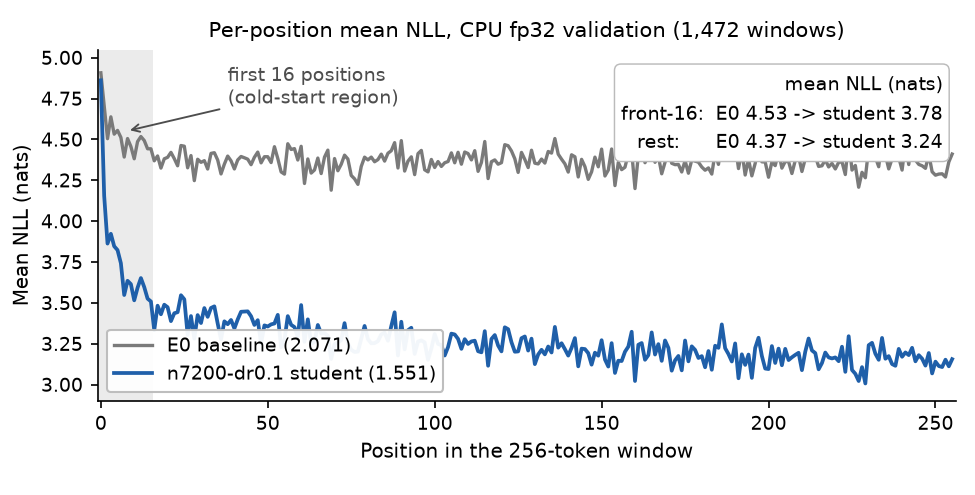
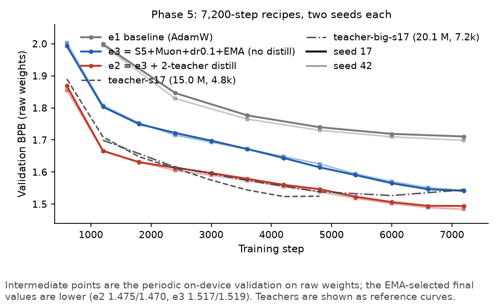
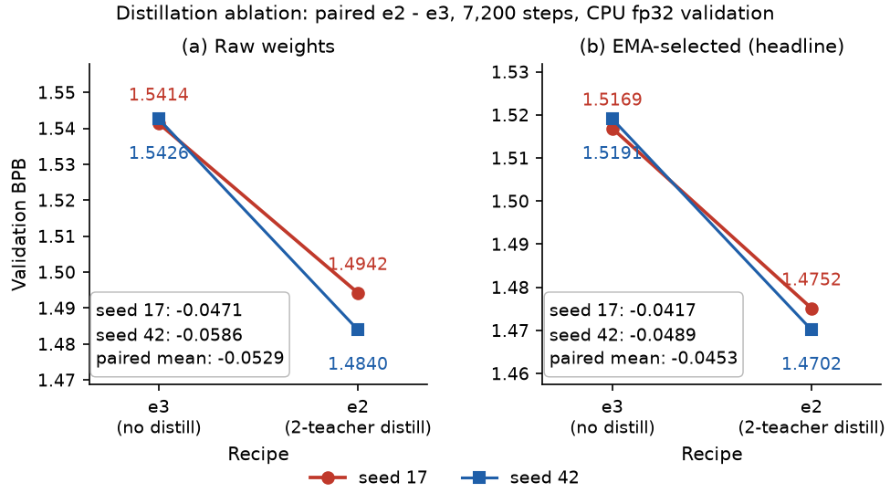
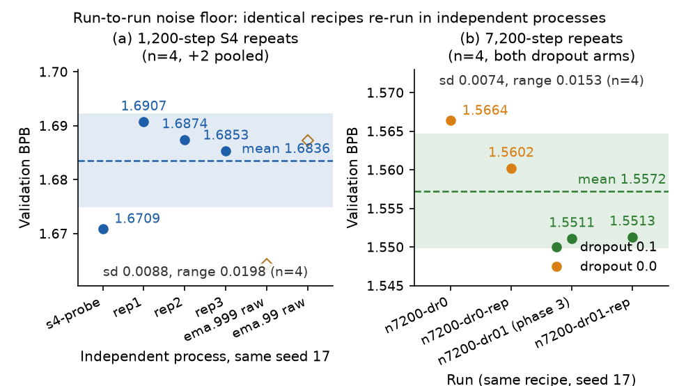

# DASE7506 MP1 小语言模型挑战赛 · 报告
学号 3036837693（王昱程）｜2026-09-22｜评测协议 `7506-mp1-wt2-v2`｜代码仓库 https://github.com/ethanwang2747/DASE7506hw1

本报告另有英文版：report-en.md。

除特别标注外，BPB 都是 **CPU fp32、validation split、选中权重** 的实测值。可复核的随包材料：`checkpoint.pt`、`config.json`、`score_test.json`、`RUN_LOG.csv`、`report/evidence.csv`（逐 run 一行，由各 run 的 `metrics.json` 生成）与 `report/figs/`。

## 1. 摘要与最终成绩

方法以 **pre-norm 架构栈（RMSNorm / SwiGLU / QK-Norm / 零初始化 / 绑定头）＋ Muon ＋ 8.9M 容量的长计划（28,800 步 ≈ 65 epoch）＋ EMA ＋ 三代 born-again 双教师蒸馏（T=4、α=0.7）** 为主线，配以「每次只动一个旋钮、双 seed 配对」的超参探底。test 2.1013 → **1.4269**（−0.674 BPB）：蒸馏的配对消融值 −0.0453，架构栈 + Muon 打包值 −0.18~−0.23。三条资源限制全部实测通过；每张表背后的逐 run 数据随包发布为 `report/evidence.csv`。

| 成绩项 | 数值 | 出处 |
|---|---|---|
| 初始基线 E0：validation / **test** BPB | 2.0711 / **2.1013** | `report/evidence.csv` |
| 等 7,200 步基线配方（双 seed 均值） | 1.7049 | `report/evidence.csv` |
| 最终冻结 validation BPB | **1.407431** | `report/evidence.csv` |
| **最终冻结 test BPB** | **1.426939** | `score_test.json` |
| test 耗时 | **28.72 s** vs 6.11 s = **4.70×**（旧锚 6.55 s → 4.39×） | `RUN_LOG.csv` |
| 峰值内存 | **2.12 GiB**（2,220,248 kB，/usr/bin/time -v） | `RUN_LOG.csv` |
| 未压缩资产 | 35,652,341 B ≈ **34.0 MiB**（8,907,696 参数） | `checkpoint.pt` |

val 1.4074 是约 100 个 run 上的选择最小值，其配方族（同配方双 seed）均值为 1.4080；val→test 的实际漂移 +0.0195（E0 锚点 +0.0302，见第 6.1 节与第 8 节）。

## 2. 协议与约束

### 2.1 评分口径

BPB 定义为

```
BPB = Σ_w Σ_t ( −log2 P(正确 token) ) ÷ 该 split 的全部原始 UTF-8 字节数
```

有两点容易读错：(1) **分母是字节，不是 token**，分词器固定不可换；(2) 文本先 BPE 编码，再按 **256 token 的不重叠窗口**切分（含末尾短窗），窗口之间不携带状态，只共享一个边界 token；**每个目标只计分一次**，首个 token 不计分但其字节计入分母。评测器还要求 `[batch, time, 2048]` 形状且全部有限（mask 不能有 `-inf`）、`|logsumexp(logp, -1)| ≤ 1e-3`。

| split | 计分目标数 | UTF-8 字节数 | token 数 |
|---|---:|---:|---:|
| train | —— | 10,951,562 | 3,613,343 |
| validation | 376,599 | 1,148,007 | 376,600 |
| test | 428,405 | 1,292,013 | 428,406 |

test/val 的字节比 1.1254、目标数比 1.1376，用来把 validation 计时外推到 test。开发与选型只看 validation：test 至今只被**基线族**跑过 3 次（E0 正式两次 + 一次 10 步冒烟），**候选学生模型 0 次**。

### 2.2 三条资源限制与预算换算

三条限制针对**同一个冻结后的预测器**测量；`evaluate.py` 的 `device_metrics()` 在 CPU 上恒返回 0，必须自己量。

| 限制 | 预算 | 冻结模型实测 |
|---|---|---|
| CPU 时间 ≤ 5× | test 6.5496 s ⇒ **32.75 s** | **28.72 s** vs 6.11 s = **4.70×** |
| 峰值内存 | ≤ 4 GiB | **2.12 GiB**（2,220,248 kB，/usr/bin/time -v） |
| 未压缩资产 | ≤ 64 MiB（≤ 16,777,216） | 35,652,341 B ≈ **34.0 MiB**（8,907,696） |

时间预算是所有尺寸决策的锚点：事前的「5× ≈ 4× FLOPs ≈ 4.1–4.5M 参数」换算偏保守——8.9M 的冻结模型实测只花 4.70×。换算只能当起点，预算须以本机实测的基线 `seconds` 为准（服务器 CPU 更慢，同模型可到 29–40 s）。

### 2.3 被约束排除的路线

| 路线 | 排除依据 |
|---|---|
| kNN-LM / 检索增强 | datastore ≈ 922 MB ≫ 64 MiB；CPU 检索必爆 5× 时间 |
| dynamic evaluation / 测试时训练 | 评测时反向传播必超 5× CPU 时间 |
| int8 量化放大单模型 | 评测固定 CPU FP32，反量化推理超时 |
| 跨 seed 直接权重平均 | 损失盆地不同；轨迹内 EMA 与 logit 集成仍可用 |
| 纯 Mamba / 线性注意力 | `selective_scan` 仅 CUDA，短序列 CPU 上更慢 |
| n-gram 输出端插值 | 另机实测无效；第 3.1 节给出其量级上限 |

### 2.4 合规性证据（每条实验后复核）

- 默认路径逐位不变：`--implementation model --steps 10` 冒烟的
  checkpoint sha256 `2ce13a32…`、validation BPB
  `3.579821969345922`、step-10 loss 与记录逐位一致（须在空闲机器上做，
  否则只对到 6e-11 相对差异）。
- 契约测试 5/5 OK；禁改文件（`model.py` / `common.py` /
  `evaluate.py` / `tests/` / `configs/baseline.json` / `data/*`）与原始
  分发包逐成员 sha256 一致。

## 3. 诊断：限制在哪

协议的两条硬约束是「独立 256 窗」与「固定 3.61M token 的课程文本」。

### 3.1 逐位置损失：窗口冷启动真实但很小

复刻 scorer 的同一套非重叠 256-token 窗口，统计每个位置的平均 NLL
（校验：Σ(每位置 NLL × 计数) 精确复现 scorer 的 BPB，E0 为
2.0710809705 vs 2.0710809771）：

| 指标 | 基线（val 2.0711） | 训练后的学生（val 1.5511） |
|---|---:|---:|
| position 0 平均 NLL | 4.9074 nats | 4.8614 nats |
| 前 16 个位置 | 4.5294 | 3.7751 |
| 后 16 个位置 | 4.3530 | 3.1508 |
| 前 16 / 后 16 | 1.0405 | **1.1981** |
| 窗口其余位置 | 4.3659 | 3.2442 |
| 前 16 占总 NLL 的份额（token 份额 6.25%） | 6.47% | 7.20% |
| **冷启动超额占总 NLL** | 0.25% | **1.19%** |

训练后的学生在前 16 个位置上比尾部贵约 20%，承载约 1.2% 的验证集总
NLL；把它们变得和尾部一样便宜值 **≈0.018 BPB**（1.5511 → ≈1.533）
——是「容量 +1.31M 参数」全部收益（0.0506）的约 1/3、seed 极差
（0.0068）的 2.7 倍，但**比撑起一个策略所需的小一个数量级**。**模型越
强，残差损失越向前几个 token 集中**（0.25% → 1.19%）。见图 1。

**图 1. 逐位置平均 NLL：基线 E0 与训练后学生在 256-token 窗口内各位置的平均损失（CPU fp32 validation）**


### 3.2 数据量 vs 参数量：真正的限制是「数据受限 + 多 epoch」

课程训练文本只有 **3,613,343 个 token**：1,200 步 = 9,830,400 个目标
≈ 2.7 epoch；7,200 步 ≈ **16.3 epoch**；14,400 步 ≈ **32.6 epoch**。
基线配方（1.09M 参数）的 token/参数比是 3.3，而 6.64M 参数的候选学生
只有 **0.54 token/参数**。「加参数」最初被排除（快筛里 8.1M 没赢过
6.6M），但该结论被推翻：容量要**配上长计划与正则**才变现——7,200 步配
dropout 0.1 后 8.9M 反超 6.6M（配对 −0.009），14,400 步时收益约翻倍；
主轴是**训练方法 × 容量**。教师侧已过拟合（15.0M / 4,800 步的教师
1.5246 优于 20.1M 教师，第 6.3 节）；学生侧尚未到拐点（四个 7,200 步
学生臂的尾部**没有一个反弹**，dropout 0 臂的末端上翘被 dropout 0.1
消除，第 5.4 节）。

## 4. 方法

### 4.1 架构栈（`code/student.py`，自包含单文件）

相对课堂基线（`model.py`：LayerNorm + 4×GELU + 可学习绝对位置 + 绑定
头）的改动：

| 改动 | 内容 | 理由 |
|---|---|---|
| RMSNorm 取代 LayerNorm | 先转 float 计算再回写原 dtype | fp16/bf16 数值稳定 |
| SwiGLU 取代 GELU-4× | hidden = 8/3 × width，取 8 的倍数 | 预算与 3·width·hidden 持平 |
| QK-Norm | 每个注意力头维度上做 RMSNorm | 稳定长计划训练 |
| 零初始化 | `attn.proj.weight` 与 `mlp.down.weight` 置零 | 每个 block 是恒等映射 |
| 绑定头 / 无偏置 | `tie=True`、`bias=False` | 与基线一致；解绑无收益（第 5.4 节） |
| 位置编码 | 保留可学习绝对位置 | context 固定为 256，RoPE 收益很小 |

架构代码必须全写在一个文件里（`common.make_model()` 只对**单文件**实现
模块做 sha256）；checkpoint 必须能只靠 `config` 重建（断言
`context == 256`、`vocab == 2048`）。

| 项 | 冻结配方的取值 |
|---|---|
| 模型 | vocab 2048 / w336 / h6 / d6 / ctx 256；RMSNorm、SwiGLU、QK-Norm |
| dropout | 0.05 |
| 优化器 | Muon（lr 0.03、momentum 0.95、解耦 wd 0.05）+ AdamW（lr 1e-3）、裁剪 1.0 |
| 计划 | 100 步 warmup + cosine 衰减到峰值 10%，共 28,800 步；32×256 = 8,192/步 |
| EMA / 蒸馏 / seed | 0.9995（EMA 1.407431 / raw 1.433284）；T=4.0、α=0.7；seed 42 |

### 4.2 Muon 优化器

Newton–Schulz 5 步正交化（系数 3.4445, −4.7750, 2.0315，bfloat16 内
完成）。参数分组：只有非输出头的 2D `nn.Linear` 矩阵交给 Muon，嵌入、
norm gain、bias、输出头留在 AdamW；更新量乘 `max(1, rows/cols)**0.5`
缩放。默认路径逐位不变（第 2.4 节）。

### 4.3 长计划 + dropout

每步随机抽 32 个起点、各取 257 个连续 token（32×256 = 8,192 个目标）；
基线配方为 AdamW lr 1e-3 / weight_decay 0.1 / 梯度裁剪 1.0、100 步
warmup 后 cosine 衰减到峰值的 10%。dropout 施加在嵌入后与两个残差分支
各一次；`nn.Dropout` 在 eval 时是恒等映射，**打分不受 dropout 影响**。
`--steps` 同时决定 cosine 周期，因此「多训步数」与「换调度形状」纠缠在
一起——4,800 步的 run 不是 7,200 步 run 的前缀（第 4,800 步时前者
1.6289，后者已收敛到 1.5596）。

### 4.4 EMA（指数滑动平均）

影子权重在每步 `optimizer.step()` 后更新：`avg = decay·avg +
(1−decay)·param`；训练结束时 raw 与 averaged 各用 CPU fp32 打一次
validation、取优者写进 checkpoint。规则是 **horizon 必须匹配计划
长度**：让 `1/(1−decay)` ≲ 步数预算的 15%。7,200 步用 0.999（horizon
1,000 步 = 13.9%，初始化残留可忽略）；14,400 步用 0.9995；1,200 步只能
用 0.99——违反时 0.999 配 1,200 步会让 30% 的随机初始化留在平均值里，
EMA 反而差 0.366 BPB。

### 4.5 多教师集成蒸馏（核心机制）

损失为逐 token 的
`α·T²·KL(log_softmax(student/T) ‖ teacher_softmax) + (1−α)·CE`；多教师
时各自 softmax 后对 log-prob 取算术平均再归一化（等价于概率的**几何
平均**再归一化）。教师用 `common.make_model(...)` 重建、设 `eval()` 与
`requires_grad_(False)`；每个教师的 path / sha256 / config / seed 都写进
`metrics.json` 的谱系字段。成本全在训练侧（每步多两次教师前向，步时约
**2.4×**）；**评测零成本**。

## 5. 证据

本节覆盖三条要求证据：初始基线、等「已处理训练目标数」的对比、核心机制
的消融（BPB 均为 CPU fp32 / validation split）。蒸馏消融两臂同配置，
**只差 `--distill-checkpoint/-T/-alpha`**；表中「Δ」为**负值 = 改善**。

### 5.1 初始基线 E0

| 配方 | 参数 | 训练目标数 | train s | val BPB | **test BPB** | 评分 s |
|---|---:|---:|---:|---:|---:|---:|
| 课堂基线 | 1,088,256 | 9,830,400 | 23.07 | 2.0711 | **2.1013** | 6.7486 / 6.5496 |

E0 是全项目**唯一跑过 test 的 run**，也是 5× 预算（32.7 s）与
val→test 换算的唯一实测锚点（比值 1.01459；加性换算 +0.0302）。两次
test 只有 `seconds` 不同：分数可复现，计时受负载影响。

### 5.2 等「已处理训练目标数」的对比（要求 2）

| 尺度 | 配方 | 参数 | 已处理目标数 | seed 17 | seed 42 | 均值 |
|---|---|---:|---:|---:|---:|---:|
| 7,200 步 | **基线配方** | 1,088,256 | 58,982,400 | 1.7109 | 1.6989 | **1.7049** |
| | 6.6M + Muon + dr0.1 + EMA | 6,640,128 | 58,982,400 | 1.5169 | 1.5191 | **1.5180** |
| | + 双教师蒸馏 T=4/α=0.7 | 6,640,128 | 58,982,400 | 1.4752 | 1.4702 | **1.4727** |
| 14,400 步 | 基线配方 | 1,088,256 | 117,964,800 | 1.6796 | —（单 seed） | 1.6796 |
| | 6.6M 学生（无蒸馏） | 6,640,128 | 117,964,800 | 1.4977 | 1.4953 | **1.4965** |
| | + 三教师蒸馏 | 6,640,128 | 117,964,800 | 1.4777 | 1.4775 | **1.4776** |

等目标数下本方法比基线配方低 **0.232 BPB**，同尺度 14,400 步对比给出
**−0.183**。这一组打包了多个变量，**不能用于归因**（见 5.3 与第 6.4
节）。基线配方无 EMA 开关。见图 2。

**图 2. 7,200 步各配方的 validation BPB 曲线：基线配方、无蒸馏学生与双教师蒸馏学生，各两个 seed（raw 权重，CPU fp32 validation）**


### 5.3 核心机制消融：蒸馏（要求 3）

| 尺度 | seed | 蒸馏臂（选中） | 对照臂（选中） | Δ（选中） | Δ（raw） |
|---|---:|---:|---:|---:|---:|
| 7,200 步 | 17 | 1.4752 | 1.5169 | **−0.0417** | −0.0471 |
| 7,200 步 | 42 | 1.4702 | 1.5191 | **−0.0489** | −0.0586 |
| 7,200 步 | **均值** | — | — | **−0.0453 ± 0.004** | −0.0529 |
| 14,400 步 | 17 | 1.4777（三 EMA 教师） | 1.4977 | **−0.0200** | — |
| 14,400 步 | 42 | 1.4775（三 EMA 教师） | 1.4953 | **−0.0178** | — |
| 14,400 步 | **均值** | 1.4776 | 1.4965 | **−0.0189**（增益随计划衰减，教师组已换） | — |

7,200 步下蒸馏的配对增益 −0.0453，两个 seed 同号同量级，约为 7,200 步
重复 run 散度（sd ≈0.003–0.007）的 7–20 倍、1,200 步噪声地板（sd
0.0088）的 5 倍——**唯一干净越过噪声地板的杠杆**。1,200 步 T/α 网格
（同配方、同 seed，只改蒸馏参数）：无蒸馏参照 1.6709；T=2.0/α=0.7 单
教师 1.5954；**T=4.0/α=0.7 单教师 1.5756**；T=2.0/α=0.9 1.6047；
T=2.0/α=0.7 双孪生教师 1.5940——每臂优于参照 0.066–0.095 BPB。网格
内部 T=4 优于 T=2 约 0.0198，α=0.9 比 0.7 差 0.0093（≈0.9 sd，未
分辨），第二个教师只值 +0.0014（0.13 sd）——它与第一个近乎孪生（只差
0.0010），故**不能**说明「多样教师」无用（集成效应见第 6.2 节）。见图 3。

**图 3. 7,200 步蒸馏的配对效应：蒸馏臂与无蒸馏对照臂，两个 seed 的 raw 与 EMA 选中值（CPU fp32 validation）**


### 5.4 其它已裁决的机制（均为配对实验）

| 机制 | 配对照据 | 结论 | 成本 |
|---|---|---|---|
| dr0.1 vs 0 | 1.5512 vs 1.5633（2 run） | 保留 0.1，**−0.0121**，2/2 一致 | 零成本 |
| EMA 0.999 | −0.0245/−0.0235/−0.0190/−0.0138 | **4/4 全选**，均值 −0.0202 | 多一次 |
| 步数 7,200 → 14,400 | 1.5180 vs 1.4965 | **仅 −0.0215**，raw 曲线走平 | 2× 训练步数 |
| Muon vs AdamW（1,200） | 1.7835/1.7620/1.7540 vs 1.8980/1.8946/1.8472 | **−0.1145 / −0.1326 / −0.0932**；lr 0.05 最佳（1.7215），优于 0.01/0.02（1.7583/1.7620） | +8–14% |
| 失败探针：解绑 / w320 / lr 0.08 | 1.6458 vs 1.6473；1.6443 vs 1.6473；1.6448 vs 1.6473 | −0.0015 / −0.0030 / −0.0025，**都不通过** | 解绑 +589,824（8.9%）；w320 +1.49M |
| 跨 seed 平均 | 0.5×（两 seed 的 EMA） | **3.2098 灾难**（成员 1.4552 / 1.4719） | 2× |
| 轨迹内 SWA（k≤4） | wd 0.05 末段快照 | 1.4594–1.4616，**不如同 run 的 EMA**（1.4578）；再平均 EMA 快照更差（1.4699） | k× |

### 5.5 最终配方的组装路径

最终配方沿「每次只动一个旋钮、双 seed 配对」贪婪组装（CPU fp32
validation，raw/EMA 取优）：

| 配方变动 | 配对差（seed 17 / 42） | 结论 |
|---|---:|---|
| weight decay 0.1 → 0.05（8.9M @14,400 步） | −0.0278 / −0.0197 | **最大单旋钮增益** |
| born-again 教师 + 28,800 步 | −0.0072 / −0.0068 | 超可加（预期 −0.0093 / 实测 −0.0121） |
| 教师换成上一代（第三代）蒸馏 | −0.0032 / −0.0008 | 方向仍正但已进噪声区 |
| dropout 0.1 → 0.05（28,800 步） | −0.0035 / −0.0028 | 放松轴同样成立（幅度小） |
| 第三代教师 + dr 0.05 @28,800 | −0.0048 / −0.0081 | 转移放大（旧教师 −0.0031）；冠军 |

路径中段的容量与步数步骤增益更小（如 −0.0033 / −0.0059），时长轴在
28,800 步饱和（再翻倍到 43,200 步的配对差 +0.0016 / −0.0037）。
**dropout 0.2 @14,400 步**配对 +0.0299（2/2 同向），「大 + 重正则 +
长」的角落并不存在；**weight decay 0.05 → 0.02** 配对 +0.0016，底部在
0.05；**WSD 调度**输 0.0161（机制见第 6.6 节）。

**MTP 辅助损失**没有进入最终模型。`student.py` 有可选的 `mtp_k`（默认
0）与 `forward_with_mtp()`（第 j 个头预测 `ids[:, t+j+2]`），**只在训练
时使用**，不花评测预算。1,200 步筛选时 w=0.1 曾过线（−0.0175），但
7,200 步的配对复核未转出增益（1.4794 vs 同配方对照 ~1.470），又一个
「短计划结论不外推」的实例。速度跑纪录里的 MTP 是**捆绑提交**（连同
解绑 / lr / weight decay 合计约 2.4%）。

## 6. 批判性分析

### 6.1 噪声地板与统计分辨力

本机 CUDA 训练在进程之间不是逐位可复现的：同命令同 seed，小模型 60 步
后 `max|ΔW| = 4.7e-3`，两个 control run 的 checkpoint 哈希不同——这是
进程级 kernel 非确定性。

| 散度来源 | 样本 | sd | 极差 |
|---|---|---:|---:|
| 同一 1,200 步配方 | 4 n=6 | **0.0088**（n=6 时 0.0107） | 0.0198（n=6 时 0.0264） |
| 同一 7,200 步配方 | 4 | **0.0074** | —— |
| 1,200 步另一配方的三 seed | 3 | 0.0035 | 0.0068 |

⇒ **单次运行的分辨力 ≈ 0.02 BPB**；1,200 步上估出的「seed 噪声
≈0.007」偏乐观。对所有 <0.02 的差值遵循两条原则：(1) **配对复现**
——dropout 两臂各 2 run、蒸馏两臂各 2 seed、EMA 4/4，落在 0.01–0.02
的差值只按「双 seed 配对同向」采信；(2) **只用 CPU fp32 最终值**——
`--eval-every` 的中间点是训练设备打分，与最终点可吻合到小数点后 4
位，但不是同一次测量。**小差值只有配对才可读**：单跑 0.0153 的差值配错
了样本，两 run 均值给的是 0.0121。

**选择偏差**需要说明：报告的冠军 val BPB 是约 100
个 run、每个 run 内 raw/EMA 两次选择、再加每 1,200 步快照的逐点比较
之上的**最小值**。在 7,200 步的 sd≈0.0074（14,400 步的 seed 极差
0.0089）下，这么多层选择会把「最优 run 的 val」系统性地压低于「该配方
的真实期望」约 0.5–1 个 sd（≈0.004–0.009）。因此本报告一律同时给出
**配方均值**与**单点最优**，所有外推到 test 的预测都用配方均值；冻结后
那一次 test 测量同时就是对这种选择偏差的实证校正。另注：0.02 是「单次
运行的配对预算」，不是噪声地板；预登记的晋级线 0.01 低于 2σ。见图 4。

**图 4. 噪声地板：(a) 同一 1,200 步配方的重复运行（n=4，另加 2 个合并样本）与 (b) 7,200 步重复运行（n=4，含两个 dropout 臂），附 sd 带（CPU fp32 validation）**


### 6.2 短计划结论的外推被长计划推翻

1,200 步的网格上曾外推：「学生只比教师高 0.027，所以 0.027 是蒸馏在该
步数下还能买到的**硬天花板**」，预期 7,200 步下蒸馏「持平或略好」，
不值得为它牺牲 dropout 0.1。7,200 步的配对实验推翻了它：**−0.0453**，
远大于 0.02，且超出当初估计的上界 0.027。两条错因：**双教师的几何平均
软目标优于任何单教师**（单教师上界不约束双教师）；**软目标在长计划下
持续起正则作用**，而不蒸馏那一路已走平。事后修正：蒸馏臂对着的第二位
教师是**退化的**（1.5447 > 学生最终值 1.4702），即便如此仍赢 0.045；
「换更好的教师增益更大」已被**推翻**——换用三个个体更强的 EMA 教师
（1.4905 / 1.4783 / 1.4760）后学生反而退步（1.4952/1.4849 vs
1.4752/1.4702），因为 EMA 让教师分布趋同变尖、软目标多样性下降。

### 6.3 大教师的长计划过拟合与 EMA 修复

三个 ≥18.6M 的教师**全部在其最终步之前反弹**：20.1M 的 w512 d6 h8
教师在 7,200 步的终点 1.5447，最低点是第 6,000 步的 1.5267
（**+0.0180**）；同一条 20M 配方的最低点在不同 run 里分别出现在 4,800
步与 6,000 步——**停止点不可复现**。
修复是**教师端 EMA**：三个 EMA 教师的收益 −0.0341 / −0.0537 / −0.0657，
各自 raw 臂与非 EMA 双胞胎只差 0.001–0.004——**收益完全来自对权重轨迹
做平均，而非训练变好**；EMA 的收益在教师尺度上远大于学生尺度（学生
−0.0202），最终配方仍用最初的非 EMA 双教师。

### 6.4 预测质量与计算成本的权衡

收益列**负值 = 改善**（val BPB 下降量）。全部 CPU fp32 validation；
评测成本相对 32.7 s 预算。

| 杠杆 | 收益（val BPB） | 训练成本 | 评测成本 | 证据 |
|---|---:|---|---|---|
| 架构栈 + Muon + dropout + 容量 | **−0.183 ~ −0.232**（打包，不可归因；Muon 单杠杆 −0.09 ~ −0.13） | 6.1× 参数，步时 +8–14% | val 7.7–9.2 → 20.7–23.8 s | 双 seed |
| 容量 S2→S4 / S4→S5（1,200 步） | −0.0506 / −0.0236 | +1.31M / +1.34M 参数 | val 17.07→20.56 / 17.62→19.31 s | 单次 + 分布对照 |
| 蒸馏一代 | **−0.0453**（7,200 步配对） | 步时 2.4× + 教师血统 | **零** | 双 seed |
| born-again 二代 | −0.0044；与 28,800 步叠加 −0.0121（**超可加**） | 零 | 零 | 2/2 |
| EMA（匹配 horizon） | −0.0202；调度相关（第 6.6 节） | 可忽略 | **零** | 4/4 选中 |
| weight decay 0.1→0.05 | **−0.0237**（最大单旋钮） | 零 | 零 | 双 seed |
| 长计划 7,200→14,400 | −0.0215 | 2× 步数 | 零 | 双 seed |
| dropout 0.2 对 0.1 | **+0.0299**（有害） | 可忽略 | 零 | 2/2 |
| 教师端 EMA（作教师组） | **+0.0174**（反输非 EMA 双教师） | 1,273–3,522 s | 零 | 2/2 |

**收益最大的两个杠杆（架构栈、蒸馏）一个买在推理时间上（冠军架构用掉
约 88% 的预算，第 8 节），另一个不花评测预算**；正则类旋钮（weight
decay、dropout）在长计划区间呈明确的「倒 U」——两轴的底都在 0.05 /
0.1，向任一方向加码都亏钱；「扩大模型本身换收益」的尝试（w320、解绑、
更大的非 EMA 教师）要么被时间预算挡住，要么被过拟合吃掉。

### 6.5 为什么在本协议下 validation BPB 是可信的选型指标

「指标在涨但模型其实在变好」的顾虑（训练目标与下游指标脱钩）在这里
**不存在**：要的是**测试集 BPB**，手上的指标是**验证集 BPB**——同一个
东西、同一套协议，只换了批文章；指标就是目标本身，背后没有「另一个更
真的能力指标」，因此没有 Goodhart 空间，val BPB 反弹，冻结后的 test
几乎必然跟着变差。残余风险只有 val→test 的**抽样漂移**，靠「冻结前不碰 test + 多 seed
复核」兜底；选型规则（0.02 晋级门槛、内部 24 s 门槛）只用 validation
与实测计时决定。

### 6.6 EMA 的收益取决于调度

在 14,400 步上做过一次干净的调度单变量 A/B（同 config / seed / 教师 /
优化器 / EMA，只差 `--schedule`）：cosine 的 EMA 比自己的 raw 好
0.0171，而 WSD 的 EMA 反而比自己的 raw **差** 0.0424——WSD 把收益压在
最后 20% 的 cooldown 里，而 ema-decay 0.9995 的等效窗口（约 2,000 步）
横跨这段剧变，平均值落在「尚未冷却」的权重上。按实际采用的选型规则
（raw/EMA 取优）WSD 输 0.0161，只看 raw 权重时它反而好 0.0009（噪声
级）。由此得到两点：(a) **EMA 不是免费午餐**，它隐含「权重在末端已接近
平稳」的前提；(b) 评价调度改动必须连 EMA 一起视为一对旋钮。WSD 未被
采纳，但它的 raw 轨迹说明**稳定段高学习率并没有把训练推得更远**——
收益只来自冷却段。

## 7. 成本披露

按 `code/RUN_LOG_TEMPLATE.csv` 的列披露。
`processed_targets_including_ancestry` 把**血统**算进去：蒸馏的学生把
教师的训练目标数也计入。下表统一为 `threads` 4、`train_precision`
fp32、`selected_on` = validation、评分用 CPU。

| run_id | 方法 | steps | 血统目标数 | 参数 | train s | val BPB | test BPB |
|---|---|---:|---:|---:|---:|---|---|
| `e0-baseline` | 基线 | 1,200 | 9,830,400 | 1,088,256 | 23.07 | 2.0711 | **2.1013** |
| `e3-s17/s42` / `e2-s17/s42` | 6.6M 学生 / + 双教师蒸馏 | 7,200 | 58,982,400 / **157,286,400** | 6,640,128 | 1662.2/1103.7；2652.6/2645.4 | 1.5169/1.5191；1.4752/**1.4702** | 未跑 |
| `e1l-s17` / `e3l-s17/s42` / `e2l-s17/s42` | 基线 / 无蒸馏 / 三教师蒸馏（`e1l` 单 seed） | 14,400 | 117,964,800 ×2 / **265,420,800** | 1,088,256 / 6,640,128 ×2 | 618.1 / 3201.0 / 3416.1 / 6490.0 / 6500.9 | 1.6796 / 1.4977 / 1.4953 / 1.4777 / 1.4775 | 未跑 |
| 教师组（8 run） | 预训练，不提交 | 4,800–7,200 | 39.3M–59.0M | 15.0M–20.1M | 926.9–3,521.9 | 1.4760–1.5447 | 未跑 |
| `s6-gen3dr005-s42` | 冻结配方：28,800 步 + 第三代 born-again 双教师蒸馏 | 28,800 | **1,040,222,400** | 8,907,696 | 1695.7 | **1.407431** | **1.426939** |

**汇总（派生量）**：已落盘训练 run 的 `train_seconds` 直接相加为
**202,443 s ≈ 56.2 GPU·小时**（含并行膨胀，**未计**每次约 7 s 的 BPE
重编码 `preparation_seconds`）。评测计时：validation 评分从 5.75 s
（基线，本地）到 26 s 量级（学生，本地 3070L）；服务器 CPU 较慢，同
模型约 29–40 s——只在同一台机器上比。

**实现与搜索成本**：实现文件只有 `student.py` 与 `train.py` 两个；搜索
共 **110 个已落盘 run**（按 `metrics.json` 计数，含冒烟与 10 步兼容性
检查）。逐 run 明细见 `submission/RUN_LOG.csv`（含 test 实测）与
`report/evidence.csv`。

## 8. 局限与风险

1. **早期证据以单 seed 为主**，1,200 步快筛时代的容量、步数结论是单次/
   单尺寸；但从组装起每一步都是同 seed 配对 + 双 seed 复核。
2. **val→test 的外推只有一个实测点**。E0 的 val→test 对（比值 1.01459 /
   加性 +0.0302）是全项目唯一的换算依据；两个 split 是不同文章，抽样
   漂移无法排除。
3. **教师停止点不可复现。** 三个大教师全部反弹，同一条配方的最低点在
   不同 run 里不同；`train.py` 只保存最终 checkpoint，反弹无法事后回避。
4. **规模贴近 5× 时间预算的边界。** 8.9M 参数的本机实测用掉约 88% 的
   validation 预算（25.5 s / 28.9 s 折算 test 对 32.75 s），服务器上约
   78%；再扩大容量必须先过计时这一关。

## 9. 参考文献

1. G. Hinton 等. *Distilling the Knowledge in a Neural Network.* arXiv:1503.02531。
2. K. Jordan. *Muon*（kellerjordan.github.io/posts/muon/）；arXiv:2502.16982。
3. K. Jordan 等. *modded-nanogpt*（github.com/KellerJordan/modded-nanogpt）。
4. *BabyLlama: knowledge distillation from an ensemble of teachers for BabyLM*。
5. J. H. Cho, B. Hariharan. *On the Efficacy of Knowledge Distillation.* ICCV 2019。
6. T. Furlanello 等. *Born-Again Neural Networks.* arXiv:1805.04770。
7. M. Muennighoff 等. *Scaling Data-Constrained Language Models.* arXiv:2305.16264。
8. M. Merity 等. *Pointer Sentinel Mixture Models.* arXiv:1609.07843。
